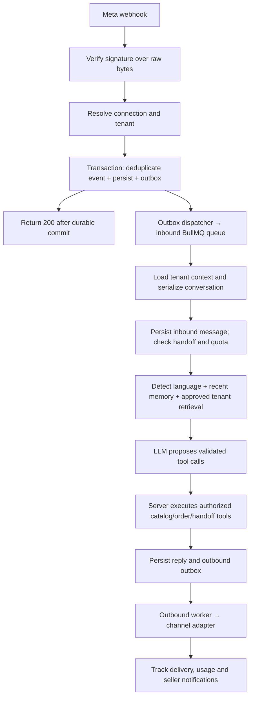

# Multilingual sales and support SaaS — proposed architecture

Status: **Architecture approved on 2026-10-07. Phase 3 authorized on 2026-10-08 and implemented for review.**

This proposal preserves the requested pnpm, Next.js App Router, NestJS, Prisma/PostgreSQL/pgvector, Redis/BullMQ, Docker Compose, and Railway stack. Product name remains undecided.

## 1. Proposed Prisma data model

All business tables carry a required `tenantId`, including join tables, queue receipts, usage records, and audit records. IDs use UUIDs; timestamps use UTC; money uses integer minor units (LKR cents). API serialization must not lose integer precision. Orders snapshot names and prices at purchase time.

The following is a model blueprint, not an applied migration. `Tenant.id` is the tenancy root. Global authentication records are the one proposed exception to the brief's literal “every table has tenantId”: a person can belong to several businesses without duplicating their identity. Approval includes approval of this exception; business access always requires membership.

| Prisma model | Main fields and constraints |
| --- | --- |
| User (global identity) | id, normalizedEmail (unique), passwordHash (nullable for Google accounts), emailVerifiedAt, createdAt |
| AuthIdentity (global identity) | userId, provider, providerSubject; unique(provider, providerSubject); never auto-link solely by email |
| Session (global identity) | userId, tokenHash (unique), expiresAt, revokedAt; opaque cookie, no browser-stored bearer token |
| AuthToken (global identity) | userId, purpose (verify/reset), tokenHash, expiresAt, consumedAt; single use |
| Tenant | id, name, slug (unique), plan, createdAt |
| Membership | tenantId, userId, role (OWNER/AGENT); unique(tenantId, userId) |
| Invitation | tenantId, normalizedEmail, role, tokenHash, expiresAt, acceptedAt |
| BotConfig | tenantId (unique), tone, enabledLanguages, greeting, rules, handoffTriggers, timezone, businessHours |
| ChannelConnection | tenantId, channel, providerAccountId, status, encryptedCredentials, encryptionKeyVersion, widgetPublicId; unique(channel, providerAccountId) for external routing |
| Customer | tenantId, name, encryptedPhone, phoneLookupHash; no uniqueness assumption about names |
| CustomerIdentity | tenantId, customerId, channelConnectionId, externalCustomerId; unique(tenantId, channelConnectionId, externalCustomerId) |
| Conversation | tenantId, customerId, channelConnectionId, mode (BOT/HUMAN), assignedMembershipId, lastCustomerMessageAt, version |
| Message | tenantId, conversationId, direction, senderType, body, language, deliveryStatus, providerMessageId, createdAt; provider deduplication scoped to connection |
| WebhookEvent | tenantId, channelConnectionId, dedupeKey, encryptedPayload, receivedAt, processedAt, state; unique(tenantId, channelConnectionId, dedupeKey) |
| OutboxEvent | tenantId, kind, aggregateId, dedupeKey, payload, state, attempts, availableAt; unique(tenantId, dedupeKey) |
| OutboundDelivery | tenantId, messageId, channelConnectionId, idempotencyKey, providerMessageId, state, attempts; unique(tenantId, idempotencyKey) |
| KnowledgeSource | tenantId, kind (WEBSITE/MANUAL), url, status, lastSuccessfulCrawlAt |
| CrawlRun | tenantId, knowledgeSourceId, status, pageCount, errorCode, startedAt, finishedAt |
| KnowledgeEntry | tenantId, knowledgeSourceId, sourceUrl, title, draftContent, approvedContent, contentHash, reviewStatus, revision |
| KnowledgeChunk | tenantId, knowledgeEntryId, revision, content, embeddingModel, embeddingVersion, embedding (`Unsupported("vector")`) |
| Product | tenantId, sku, nameEn, nameSi, nameTa, description, imageUrl, active; unique(tenantId, sku) |
| ProductVariant | tenantId, productId, sku, attributes, priceMinor, stock, active; unique(tenantId, sku); every product has a default variant |
| OrderDraft | tenantId, conversationId, customerId, validatedItems, encryptedDeliveryDetails, quoteHash, expiresAt, confirmedByMessageId, state |
| Order | tenantId, customerId, conversationId, draftId, orderNumber, status, paymentMethod, totalMinor, currency, encryptedDeliveryDetails; unique(tenantId, draftId), unique(tenantId, orderNumber) |
| OrderItem | tenantId, orderId, productVariantId, nameSnapshot, quantity, unitPriceMinor, lineTotalMinor |
| Payment | tenantId, orderId, method, providerReference, amountMinor, currency, status; unique(tenantId, providerReference) |
| PaymentAttachment | tenantId, paymentId, privateStorageKey, mediaType, sizeBytes, reviewStatus, reviewedByMembershipId |
| UsageWindow | tenantId, customerId, startedAt, expiresAt; rolling 24-hour customer window, independent of channel |
| UsagePeriod | tenantId, periodStart, periodEnd, conversationsUsed; unique(tenantId, periodStart) |
| MessageUsage | tenantId, messageId, channel, language, model, inputTokens, outputTokens, estimatedCost, rateVersion |
| Notification | tenantId, type, entityId, readAt; durable seller dashboard notification |
| AuditEvent | tenantId, actorUserId, action, entityType, entityId, redactedMetadata, createdAt |

### Enforced relationships and authorization

Every referenced business record exposes `@@unique([tenantId, id])`; business foreign keys include both fields. For example, `OrderItem.order` references `Order.[tenantId, id]` using `[tenantId, orderId]`. A valid ID from another tenant must fail even at the database layer. Every business query and unique lookup includes authenticated tenant context; request bodies cannot set it.

The NestJS guard resolves the session and checks membership for the selected tenant on every request. Owner: settings, catalog, knowledge, channels, team, usage, and payment approval. Agent: inbox, replies, handoff, and permitted order operations. Workers receive tenant context from durable records, not customer text. Global auth tables are accessible only to the auth module.

Postgres row-level security is proposed as defense in depth for business tables, using a non-owner application role and transaction-local tenant context. A narrowly scoped webhook-routing function resolves the tenant from a verified provider account ID. Migration privileges are separate. Vector SQL follows the same transaction context and explicit tenant predicate.

SQL migrations add pgvector, check constraints for nonnegative prices/stock and positive quantities, and the chosen vector dimension/index after the embedding provider is approved. No embedding provider or paid service is assumed.

### Important transactional guarantees

- Inventory decrement, order/items creation, draft consumption, and seller notification outbox entry occur in one transaction. Lock affected variants in deterministic order and recheck stock and quote; changed prices require a new customer confirmation.
- The customer must confirm a server-generated quote bound to their conversation and a still-valid draft. A model-supplied `confirmed: true` is insufficient. Order status lookups also require the current customer's ownership.
- Rolling usage-window creation and period-counter updates lock the tenant/customer metering state to prevent concurrent double counts. Unknown identities on separate channels remain separate customers until explicitly linked.
- Webhook receipt and outbox entry commit together. BullMQ publication can be retried after Redis outages without losing the receipt.

## 2. Module and repository layout

```text
apps/
  web/                         Next.js App Router, TypeScript, Tailwind
    app/(marketing)/
    app/(auth)/
    app/(dashboard)/           onboarding, inbox, orders, catalog, knowledge,
                               bot settings, channels, team, usage
  api/                         NestJS API and separate worker entry point
    prisma/                    schema, reviewed SQL migrations, seed
    src/
      auth/ tenancy/ plans/ database/
      catalog/ knowledge/ crawling/ embeddings/
      llm/ conversations/ tools/ languages/
      channels/                WhatsApp, Messenger, Instagram, widget adapters
      webhooks/ queues/ outbox/
      orders/ payments/ notifications/ usage/ audit/
packages/
  shared/                      Zod contracts, DTO types, language/channel enums,
                               plan configuration; no server secrets
infra/                         Compose and Railway service configuration
tests/                         integration/security fixtures and E2E scenarios
.github/workflows/             lint, typecheck, tests, builds, migration checks
```

`LlmProvider` exposes structured generation/tool requests and usage metadata. `EmbeddingProvider` separately exposes vectors, dimension, and version. `ChannelAdapter` normalizes inbound events and supports text/interactive sends plus channel-specific eligibility checks. Zod validates tool arguments; server-side authorization and business checks remain authoritative.

Separate BullMQ queues handle inbound processing, outbound sends, crawling, and embeddings. API and workers share NestJS modules but run as separate processes. Per-conversation database locking/version checks preserve ordering and prevent bot replies after human takeover. Dashboard updates use authenticated server-sent events; persisted state is authoritative after reconnect.

Local development runs PostgreSQL with pgvector and Redis through Compose; web, API, and workers are independently runnable. Railway deploys these services separately. Production secret storage, backups, and private payment-slip storage need deployment configuration; local adapters allow development without purchased services.

## 3. Message flow



Batch webhook envelopes are split into tenant-scoped event records after signature verification, without storing other tenants' data inside a tenant's payload. Dedupe keys distinguish inbound messages from delivery-status events. Duplicate receipts return success; storage failure returns a retryable failure rather than acknowledging lost data.

The widget uses a separate rate-limited session/bootstrap route and enters the same engine after validation. Its public embed ID is not authorization to read transcripts: sessions receive narrowly scoped, expiring conversation credentials and configured-origin checks.

Inbound workers first evaluate bot/human mode, explicit human requests, and quota. Uncertainty or exhausted quota creates a durable handoff and seller notification, with a polite localized customer reply. Language labels include English, Sinhala, Tamil, Singlish, and Tanglish; ambiguity uses conversation context or clarification rather than forced confidence.

Retrieved pages and customer text are untrusted content. Only approved knowledge revisions enter retrieval. Crawling honors robots.txt, same-domain/depth/page limits, network timeouts and byte limits, and blocks private/local network destinations including redirects and DNS rebinding. Re-crawls create drafts without overwriting owner-approved edits.

The model cannot supply prices, availability, totals, payment status, or order IDs as authoritative facts. Tool results render those facts through deterministic localized templates/cards; order confirmation and receipts are always server-rendered. Grounded policy answers include internal source references; missing or conflicting evidence triggers clarification or handoff.

Outbound sends retry with backoff and stable internal keys. Provider delivery is not assumed exactly once: a timeout after provider acceptance can be ambiguous, so record an unknown outcome and reconcile where possible before retrying. WhatsApp eligibility uses the last inbound customer-message timestamp; outside its allowed window use only an approved eligible template or escalate. Meta-specific behavior will be verified against official documentation in Phase 4.

PayHere notifications are verified before state changes, with server-side order/amount/currency matching and idempotency. A browser return URL never marks an order paid. Bank-transfer slips remain private and require owner approval. Credentials and exact provider integration details await owner input in Phase 5.

## 4. Build and review gates

1. **Foundation:** pnpm workspace, auth (email/password and configurable Google sign-in), tenant selection/memberships/roles, plan config, migrations, Docker Compose, CI, dashboard shell. Include meaningful cross-tenant and role tests. Google integration is implemented with configuration instructions; no credentials or live activation assumed.
2. **Catalog and knowledge:** product/variant CRUD, validated CSV import, manual and crawled knowledge review, safe crawler, embedding abstraction and tenant-scoped retrieval. Use a clearly labeled deterministic development embedding adapter until a real provider is approved.
3. **Engine and widget:** provider abstraction, local fake provider, typed tools, language detection, widget sessions, recent memory, token accounting and handoff. Catalog tools execute; order tool contracts return unavailable until Phase 5. At least 30 labeled language fixtures, six for each required language/script style, plus ambiguity cases.
4. **Meta:** verified webhook ingestion, deduplication, all three channel adapters, encrypted credentials, delivery tracking and WhatsApp window rules. Verify signatures, replay handling, multi-tenant envelopes, and queue recovery in integration tests. Live app setup/review requires owner input.
5. **Commerce and inbox:** server quotes/customer confirmation, transactional orders, payment workflows, inbox/live updates, human takeover and seller notifications. Test cross-customer order access, replayed confirmation, stock contention, changed prices, and payment forgery/replays.
6. **Metering and hardening:** complete rolling-window quota enforcement, concurrency tests, rate limits, RLS audits, retry/dead-letter operations, log redaction, retention configuration and deployment readiness. Foundational security, tenant scoping, and signatures are implemented in their owning phases, not deferred here.

Each phase ends with focused reviewable commits, a README run/test note, verification results, and a stop for owner review. No publishing, paid subscriptions, or live channel activation is included in architecture approval.

## 5. Approval requested

Approve this architecture to begin Phase 1, including the explicitly scoped global-identity exception. Plan numbers, product branding, external credentials and provider selection can remain open while Phase 1 is built with clearly labeled development configuration.
